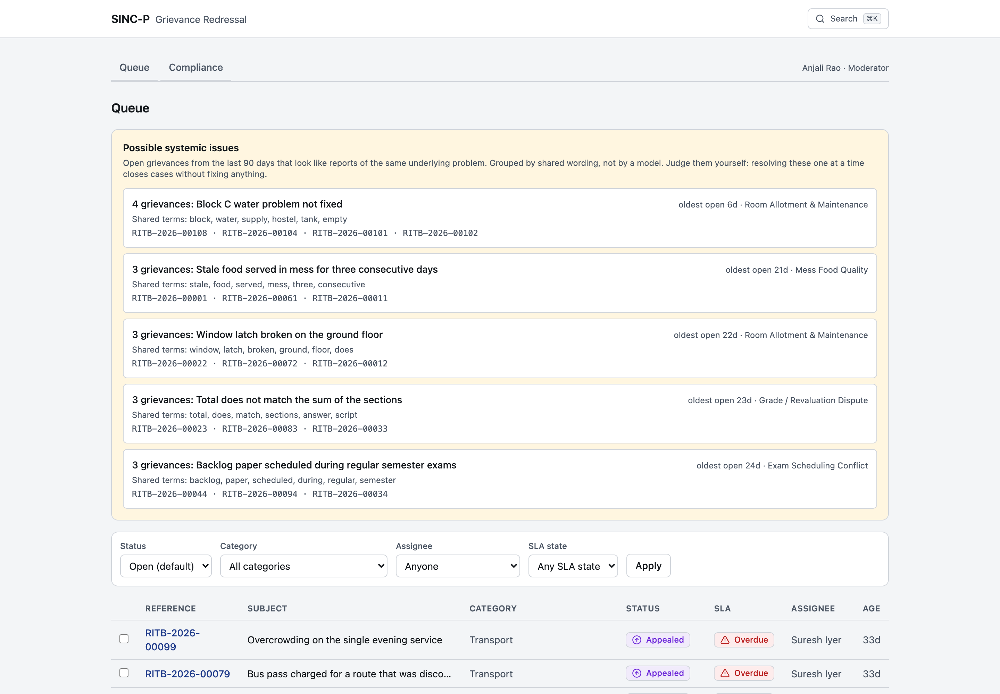

# SINC-P

A grievance system for Indian colleges that puts a statutory deadline on every complaint and keeps a record nobody can quietly edit. It follows the UGC (Redressal of Grievances of Students) Regulations, 2023: a Student Grievance Redressal Committee, a resolution clock, and an Ombudsperson appeal tier.

In 2019 four of us at MANIT Bhopal wrote an SRS for three things: campus **I**nformation, campus **N**ews and student **C**omplaints. We built only the complaints part, and it was a PHP complaint-box template from the internet whose categories still read *E-commerce*, *Online Shopping* and *E-wallet*. Nobody changed them. This repo is the idea done properly, seven years later, with none of the 2019 code left in it.

It is a working application with seeded demo data and no customers. There has never been a pilot. See [what is and is not built](#what-is-and-is-not-built).



## Why this and not a chat widget

Most campuses already have a complaints channel, and it is an email address. Nobody can tell you whether anyone read the message, who owns it now, or whether the UGC window has already run out. Accreditation visits (NAAC, NBA) ask to see those records, and a spreadsheet cannot prove a response time.

So the buyer I had in mind is the Registrar or the Dean of Student Welfare, and the thing they are short of is audit readiness. I put the product question to seven models from different families and wrote up the ruling, the dissents and the two places I overruled the majority in [ADR-0001](docs/decisions/0001-product-and-architecture.md). The dissent that changed the build: a compliance record with no student filing into it is an audit export of zero rows. That is why the system publishes anonymised closure times with no login, on `/transparency`.

## What it does

- **A clock on every case.** Each grievance gets a `dueAt` from its category override or the institution default, in Asia/Kolkata, in calendar or working days. The regulation says "15 working days" and the first version counted calendar days, which would have reported breaches that never happened. Working days is now the default (`slaUseWorkingDays`).
- **An append-only trail.** `grievance_events` is hash-chained: each event commits to the one before it, so an edited remark or a deleted escalation fails verification at a specific sequence number. A `BEFORE UPDATE OR DELETE` trigger and a `REVOKE` enforce it. The UI says tamper-evident, not tamper-proof, because that is what it is.
- **Tenant isolation you can attack.** Application scoping, a transaction-local tenant setting, `FORCE ROW LEVEL SECURITY` and a runtime role that is neither owner nor superuser. [`docs/verification/run.sh`](docs/verification/run.sh) starts a throwaway Postgres and tries to break all of it.
- **Three statutory tracks.** `grievances.track` is `sgrc`, `icc` or `anti_ragging`. An ICC case under the PoSH Act is visible to the Internal Complaints Committee and nobody else, including the moderator and the Registrar. The check runs per record (`canView`) and in the list query (`accessibleTracks`), because a per-record check does not protect a list endpoint.
- **Small numbers are hidden.** Any published figure computed from fewer than five grievances renders as a dash, enforced in the query layer. In one department a count of one is a name.
- **AI that suggests and never decides.** Off by default, text redacted before it leaves the machine, every suggestion logged. Urgency detection and clustering of similar complaints run locally with no model. Rules and reasoning are in [ADR-0002](docs/decisions/0002-ai-and-agents.md).
- **A bounded agent.** `npm run agents:run` sweeps for breached deadlines, escalates, queues notifications and records each action in the same chain. It cannot close a case or set a status a human owns.

## Run it

Needs Node 24 or newer (`.nvmrc`), and Docker for Postgres 17.

```bash
cp .env.example .env.local
npm install
npm run db:up
npm run db:push
npm run db:seed
npm run dev
```

Then open http://localhost:3000. `db:push` applies the schema, then the row-level security policies, then asserts they are on. The seed builds two institutions on purpose, so you can try to read one from the other. It verifies every hash chain it writes and prints the dev password for all seeded users when it finishes.

| To see | Sign in as |
|---|---|
| The student view | `aarav.sharma@rit-bhopal.sincp.demo` |
| The moderator's triage queue | `anjali.rao@rit-bhopal.sincp.demo` |
| The officer console | `suresh.iyer@rit-bhopal.sincp.demo` |
| Appeals (Ombudsperson) | `ramesh.chandran@rit-bhopal.sincp.demo` |
| Users, categories, settings | `meera.joshi@rit-bhopal.sincp.demo` |

To deploy on a bare box, `docker compose up -d --build` starts Postgres, a one-shot migration container and the app. Read [docs/deployment.md](docs/deployment.md) first and set real values for `DB_OWNER_PASSWORD`, `DB_APP_PASSWORD` and `SESSION_SECRET`.

## Checking it

```bash
npm test                  # unit and integration, e2e excluded
npm run typecheck         # tsc strict, then scripts/check-server-actions.mjs
npm run lint
npm run db:check-rls      # RLS is enabled, forced and has a policy
./docs/verification/run.sh
npm run test:e2e          # needs the app running
npm run audit             # fails on a high or critical advisory
```

Some suites talk to a real Postgres on purpose, because row-level security and triggers are database behaviour and a mock would assert nothing. Without a database they skip and print the command to run. Coverage thresholds in `vitest.config.ts` are 70% lines, 65% functions, 60% branches. CI runs typecheck, lint, the RLS check, `run.sh`, coverage and the build; the strategy is in [docs/testing.md](docs/testing.md).

## How it is built

Next.js 16 App Router with Server Components throughout, React 19, Tailwind 4, TypeScript strict with `noUncheckedIndexedAccess`, Drizzle on Postgres 17, Zod at the boundaries, Vitest. No data fetching on the client: pages call a service layer, only the service layer touches the database, and the database does not trust the service layer either.

```
src/db/schema.ts        12 tables; tenant rows carry institutionId
src/db/client.ts        withTenant(), the only door into tenant data
src/lib/grievance/      policy.ts (authz + state machine), audit.ts (chain),
                        sla.ts (clock), service.ts (public barrel), commands.ts (writes),
                        queries.ts (reads)
src/lib/auth/           scrypt, server sessions, CSRF, rate limiting
src/lib/ai/             provider seam, redaction, triage, clustering
src/lib/agents/         the SLA watchdog
src/proxy.ts            mints the CSRF cookie
drizzle/0001_rls.sql    policies, roles, append-only trigger
```

`proxy.ts` is not a typo for `middleware.ts`. Next 16 renamed the convention, and a `middleware.ts` is silently never invoked. The symptom was CSRF failing on every form with nothing in the logs.

Every mutation writes its audit event in the same transaction as the state change, so if the event write fails the change rolls back. Event hashes join their fields with `U+001F`; joined with nothing, `("ab","c")` and `("a","bc")` hash the same. The reasoning and the module boundaries are in [docs/architecture.md](docs/architecture.md).

## Three bugs that only running it found

Each read correctly in review.

1. **The RLS bypass could grant itself.** The policy keyed off `current_setting('app.bypass_rls')`, and any role can set its own settings. The app role could run one `set_config` and read every institution. The policy now asks `pg_has_role(...)`, which `sincp_app` cannot grant itself.
2. **`drizzle-kit push` silently turns RLS off.** It recreates tables to apply changes, and the flags and policies do not survive. Nothing errors and every page still shows the right rows, because application scoping still filters. I measured `relrowsecurity` going true to false and policies from 1 to 0 across one push. `npm run db:push` now chains `db:rls` and `db:check-rls`.
3. **Login was broken under RLS and I demoed it anyway.** `sessions` is a tenant table but `session.ts` queried it with the unscoped client. I had shown login working while bug 2 had RLS switched off, then re-enabled RLS and never retried it.

What I took from them: check that a guard fires, not that it is configured. The append-only checks in `run.sh` run as the table owner for the same reason. Run as the unprivileged role they pass for the wrong reason, because the `REVOKE` stops the statement before the trigger is reached, and the first version of the suite made that mistake.

## What 2019 got wrong

| 2019 | Now |
|---|---|
| Every query built by string concatenation, so `' OR '1'='1' -- ` in the login box logged you in as the first user | Parameterised queries, with RLS underneath |
| `md5()` with no salt | scrypt (N=2^16) with a per-password salt and the parameters stored with the hash |
| `complaint-details.php?cid=5` with no ownership check | `canView(actor, grievance)` on every read path |
| `$_FILES` moved into a web-served folder under the user's own filename | Content sniffed, size capped while streaming, opaque keys outside the web root |
| Remarks editable in place | Hash-chained, append-only events |
| Password reset matched email and phone number, no token | The phone-number reset is gone. No replacement flow exists yet; the token table is in `drizzle/0002_password_reset_tokens.sql` and nothing calls it |

The full construct-by-construct list, and how a real 2019 database migrates (`npm run db:import-legacy`, which refuses to carry md5 hashes across and never back-dates a deadline), is in [docs/migration-from-2019.md](docs/migration-from-2019.md).

## What is and is not built

Built and exercised: the grievance lifecycle (file, triage, assign, remark, resolve, close, withdraw, appeal), tenant isolation, the audit chain, the SLA engine, ICC and anti-ragging routing, the legacy importer (checked against the real 2019 `cms.sql`: 22 complaints, 5 remarks), a transactional email outbox with an SMTP client written on `node:net` and `node:tls`.

Deliberately thin: news and the handbook. Information pillar covers the statutory disclosures the UGC requires to be published.

Not built, or not proven:

- SSO. There is an OIDC seam with nothing behind it.
- Password reset. The table for single-use tokens exists and no screen or service uses it.
- Malware scanning on uploads, field-level encryption at rest, MFA.
- Retention, per-student erasure and breach notification, which the DPDP Act puts on whoever runs this.
- The ICC's own inquiry workflow, and the Anti-Ragging Committee as a distinct body (the track and its short clock exist).
- Urgency detection is English only. A complaint in Hindi or Hinglish will not trip it.
- The SMTP transport has never run against a real relay, and AI assist has only met a local OpenAI-compatible endpoint and test fakes.
- Attachments use a local disk driver. S3 is a documented seam.
- No customer, no pilot, no design partner.

The security document lists eight open gaps by name: [docs/security.md](docs/security.md).

## Docs

| | |
|---|---|
| [flow.md](docs/flow.md) | One grievance end to end, screen by screen |
| [architecture.md](docs/architecture.md) | Why the boundaries sit where they do |
| [glossary.md](docs/glossary.md) | SGRC, ICC, IQAC, NAAC, AISHE, PoSH, DPDP. Start here if the domain is new |
| [compliance.md](docs/compliance.md) | Each regulatory requirement with a source link and the gaps named |
| [security.md](docs/security.md) | Threat model, evidence, open gaps |
| [verification/](docs/verification/) | The tenant-isolation script and its results |
| [decisions/](docs/decisions/) | ADR-0001 product and architecture, ADR-0002 what AI may do |
| [deployment.md](docs/deployment.md), [operations/runbook.md](docs/operations/runbook.md) | Deploying, and what to do when it breaks |
| [gtm/](docs/gtm/) | Positioning, pricing, targeting and objections. Not code |
| [CONTRIBUTING.md](CONTRIBUTING.md) | Setup and the four things not to break |

## Credits

The 2019 project was Siddharth Pandalai, Nashit Shayan Khan, Nalin Gupta and Albin Thomas at MANIT Bhopal. The idea, the three pillars and the escalation ladder in the SRS are theirs too.

## Licence

AGPL-3.0, see [LICENSE](LICENSE).
